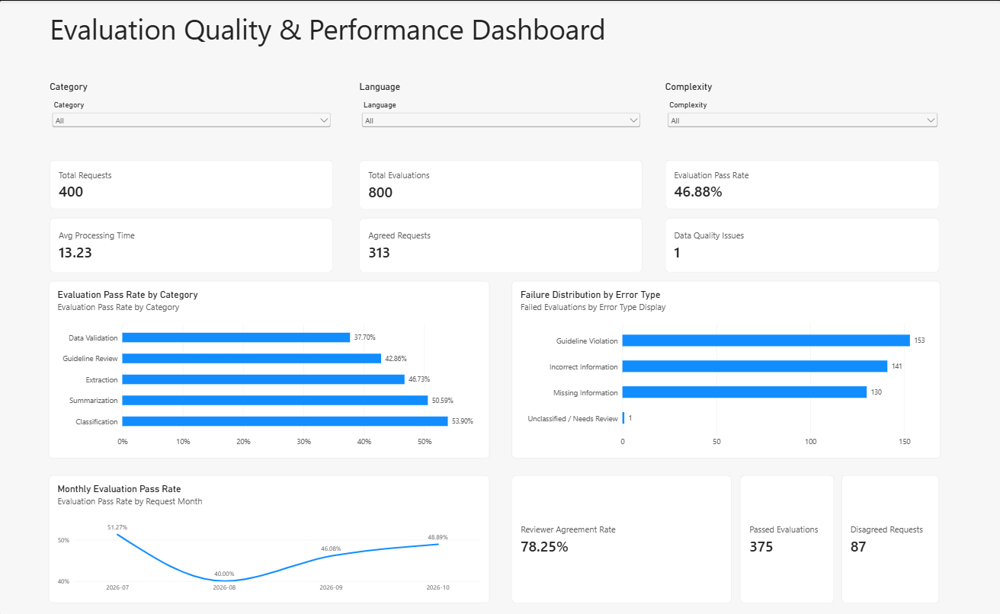
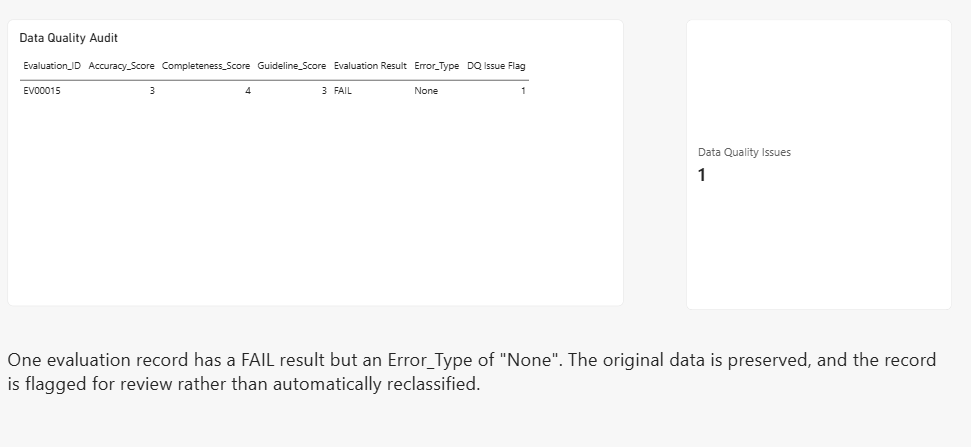

# Data Quality & Evaluation Performance Analytics

An end-to-end data analytics portfolio project focused on data cleaning, data quality validation, KPI analysis, and interactive reporting for a simulated text-processing evaluation workflow.

**Project type:** Synthetic data analytics project  
**Tools:** Python, Power Query, SQLite, SQL, Power BI (DAX), Git, GitHub  
**Dataset period:** July–October 2026

## 1. Project Overview

This project analyzes the quality and processing performance of a simulated text-processing workflow.

The dataset contains:

- **400 requests** across five categories.
- **800 evaluations**, with two independent reviewers per request.
- Evaluation scores for accuracy, completeness, and guideline compliance.
- Processing timestamps, processing duration, error types, and reviewer information.

The project focuses on three areas:

1. **Output quality:** How often do evaluations meet the defined quality criteria?
2. **Processing performance:** How many requests are processed, and how long do they take?
3. **Evaluation consistency:** How often do reviewers agree on PASS/FAIL decisions?

The project also identifies data quality issues that could affect reporting accuracy.

## 2. Business Questions

- What is the overall evaluation pass rate?
- Which request categories have the highest and lowest pass rates?
- What are the most common failure types?
- How does evaluation quality change over time?
- How consistent are the two reviewers?
- Are there any data quality issues that require investigation?

## 3. Dataset and Business Rules

The project uses two main tables:

**requests**

One row represents one text-processing request.

Key fields include `Request_ID`, `Created_At`, `Completed_At`, `Category`, `Language`, `Complexity`, and `Processing_Time_Min`.

**evaluations**

One row represents one review of a request.

Key fields include `Evaluation_ID`, `Request_ID`, `Reviewer_ID`, `Accuracy_Score`, `Completeness_Score`, `Guideline_Score`, and `Error_Type`.

Each request is evaluated by two distinct reviewers.

### Evaluation Rule

An evaluation is classified as **PASS** only when all three scores are at least 4 out of 5:

- Accuracy Score >= 4
- Completeness Score >= 4
- Guideline Score >= 4

Otherwise, the evaluation is classified as **FAIL**.

**Evaluation Pass Rate = Passed Evaluations / Total Evaluations × 100**

Pass rate is calculated at the evaluation level, not the request level.

The scoring rubric and thresholds were defined for this synthetic project. In a real business environment, they would require agreement with business stakeholders and domain experts.

## 4. Workflow

1. **Data generation:** Created synthetic request and evaluation records using Python.
2. **Data preparation:** Cleaned and transformed data using Power Query.
3. **Data validation:** Used SQLite and SQL to check keys, missing values, domains, timestamps, reviewer assignments, and business rules.
4. **KPI analysis:** Calculated quality, processing, error distribution, and reviewer consistency metrics using SQL.
5. **Visualization:** Built an interactive Power BI dashboard with DAX measures and category, language, and complexity slicers.
6. **Quality monitoring:** Flagged inconsistent evaluation records without overwriting the original values.

## 5. Key Results

| Metric | Result |
|---|---:|
| Total Requests | 400 |
| Total Evaluations | 800 |
| Passed Evaluations | 375 |
| Failed Evaluations | 425 |
| Evaluation Pass Rate | 46.88% |
| Average Processing Time | 13.23 minutes |
| Agreed Requests | 313 |
| Disagreed Requests | 87 |
| Reviewer Agreement Rate | 78.25% |
| Data Quality Issues Detected | 1 |

## 6. Analytical Findings

### Category Performance

Classification recorded the highest evaluation pass rate at **53.90%**, while Data Validation recorded the lowest at **37.70%**.

The difference was **16.20 percentage points**.

### Failure Distribution

Among 425 failed evaluations:

- Guideline Violation: 153
- Incorrect Information: 141
- Missing Information: 130
- Unclassified / Needs Review: 1

### Monthly Quality Trend

Evaluation pass rates by request creation month:

| Month | Pass Rate |
|---|---:|
| July 2026 | 51.27% |
| August 2026 | 40.00% |
| September 2026 | 46.08% |
| October 2026 | 48.89% |

The pass rate declined in August before recovering during September and October.

### Reviewer Consistency

Reviewers agreed on PASS/FAIL decisions for **313 of 400 requests**, resulting in a **78.25% agreement rate**.

The average absolute difference across the three reviewer score dimensions was approximately **0.60 points**.

## 7. Data Quality Findings

SQL validation identified one evaluation record, `EV00015`, with an inconsistent error classification:

- Accuracy Score: 3
- Completeness Score: 4
- Guideline Score: 3
- Derived Result: FAIL
- Original Error Type: None

The original record was preserved and flagged for review.

In Power BI, the record is displayed as **Unclassified / Needs Review** for reporting purposes, without changing the source `Error_Type`.

During SQL validation, single-digit hour formatting in timestamp strings also required normalization to avoid false validation failures.

## 8. Power BI Dashboard

### Overview



The dashboard includes KPI cards, category pass rates, failure distribution, monthly trends, reviewer agreement metrics, and interactive slicers.

### Data Quality Audit



The audit page displays the flagged evaluation record and explains why it requires review.

## 9. Repository Structure

```text
data/
  canonical/
  raw/
  processed/
docs/
powerbi/
  evaluation_dashboard.pbix
screenshots/
scripts/
  generate_dataset.py
  inject_data_issues.py
sql/
  data_quality_checks.sql
  kpi_analysis.sql
README.md
```

The SQLite database file is excluded from version control. The SQL scripts and processed CSV files are included for reproducibility.

## 10. How to Reproduce

1. Clone this repository.
2. Open DB Browser for SQLite and create a new database.
3. Import `data/processed/requests_cleaned.csv` into a table named `requests`.
4. Import `data/processed/evaluations_cleaned.csv` into a table named `evaluations`.
5. Run `sql/data_quality_checks.sql` to validate the data.
6. Run `sql/kpi_analysis.sql` to reproduce the KPI results.
7. Open `powerbi/evaluation_dashboard.pbix` in Power BI Desktop to explore the interactive report.

## 11. Limitations

- All records are synthetic and do not represent actual business operations.
- The evaluation rubric is simplified and shared across different task categories.
- No formal SLA or performance targets were defined.
- Reviewer agreement is based on binary PASS/FAIL decisions rather than a chance-adjusted agreement statistic.
- One inconsistent error classification remains flagged for review.
- Power BI Desktop is required to interact with the `.pbix` file.

## 12. Skills Demonstrated

- Data cleaning and transformation with Power Query
- SQL data quality validation
- Relational joins and KPI aggregation
- DAX measures and calculated columns
- Interactive Power BI dashboard development
- Data quality issue identification and documentation
- Git-based version control and project documentation
